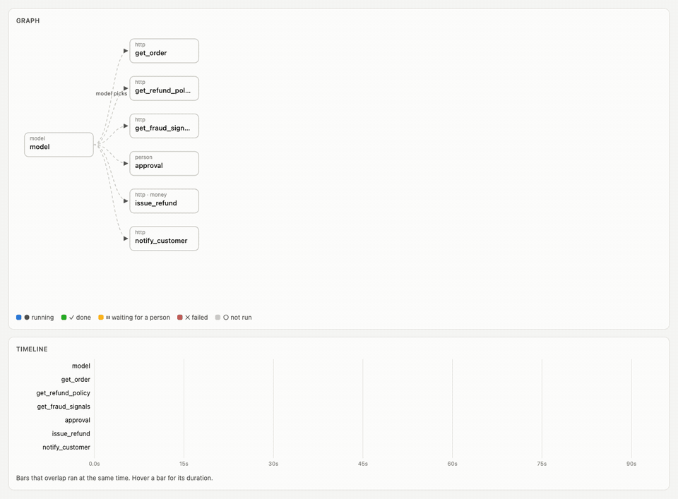
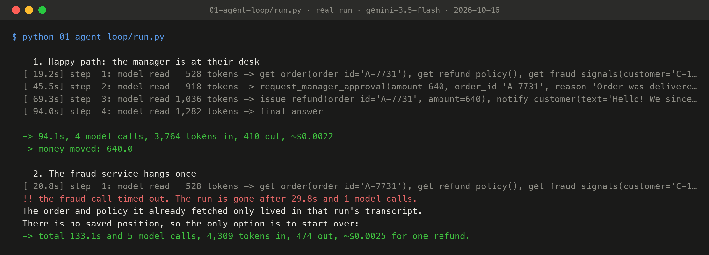

# Stage 1: the agent loop

The design behind most agents of the last two years: put a model in a loop, give it tools, and let it decide what to do next until it says it's done.

```python
contents = [customer_message]
while True:
    response = gemini.chat(SYSTEM, contents, TOOLS)    # the model is the only scheduler
    if not response.function_calls:
        return response.text
    contents += [response, run(response.function_calls)]   # the transcript is the only memory
```

[`agent.py`](agent.py) is exactly that, about 40 lines, with Gemini's function calling and six tools over the platform's HTTP API: `get_order`, `get_refund_policy`, `get_fraud_signals`, `request_manager_approval`, `issue_refund`, `notify_customer`.

## Run it

```bash
make platform                                  # terminal 1
.venv/bin/python 01-agent-loop/run.py          # terminal 2: all scenes, about 2 minutes
.venv/bin/python 01-agent-loop/run.py happy    # or one scene: happy | timeout | away
```

## What happened on a real run (gemini-3.5-flash, 2026-10-16)

| Scene | Result |
|---|---|
| **Happy path** | Right answer: $640 under §1, approved by the manager under §3, refunded, customer told. 4 model calls, 33.8 s. The model read 528, then 1,093, 1,440 and 1,748 tokens: **every call re-reads the whole transcript.** |
| **The fraud service hangs once** | The run dies at 12.9 s. Order and policy had already come back, but they only lived in that run's transcript. Starting over brought it to **46.8 s and 6 model calls** for one refund. |
| **The manager is out until Thursday** | The loop polled the approval for 15 s and gave up, leaving a pending approval behind. Waiting longer means holding the process, the connection and the context open for days. |

One thing a modern model does better than the textbook loop: Gemini asked for all three lookups **in a single turn**. Our loop still ran them one after another (6 s instead of 2 s). You could thread them, but then you're building a scheduler inside the loop, which is where the next stages go anyway.

## Recorded run



*Replay of real run `0b9e7fa2`: 61 frames sampled evenly over its 94 s (about 9× speed), captured by Playwright from `/ui?replay=0b9e7fa2` and assembled with ffmpeg by [`viz/make_gif.sh`](../viz/make_gif.sh). An MP4 of the same frames sits next to it.*



*Terminal output of `python 01-agent-loop/run.py`, recorded on 2026-10-16 with gemini-3.5-flash (full text: [`output.txt`](output.txt)), rendered to PNG by [`viz/terminal.py`](../viz/terminal.py) from the file, not retyped.*

On this run the loop read 528, 918, 1,036 and 1,282 tokens across its four calls (3,764 in total), and the hung fraud call made one refund take 133 s and 5 model calls. Free-tier latency changes from run to run (3 to 30 s per model call), so the times here differ from the table above. Compare model calls, tokens and rounds, not seconds.

## Where it breaks

A loop is a scheduler whose ready list always has one item, picked by a model call you can't inspect. That explains every failure above:

1. **Serial.** Independent work doesn't overlap.
2. **All-or-nothing.** With no saved position, one failure throws away every finished step.
3. **No pause.** A person in the process can only be waited on by blocking.
4. **State is a transcript.** Nothing has a name, there's no record per step, and the context grows with every call (long inputs also make models less accurate).

A smarter model fixes none of these, because they're properties of the structure around the model. **Next:** [stage 2](../02-explicit-graph/) writes that structure down.
