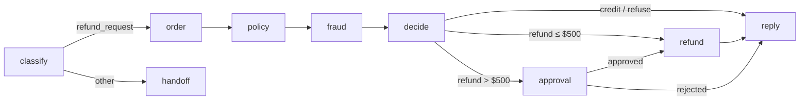
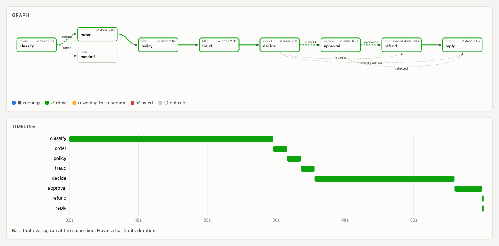
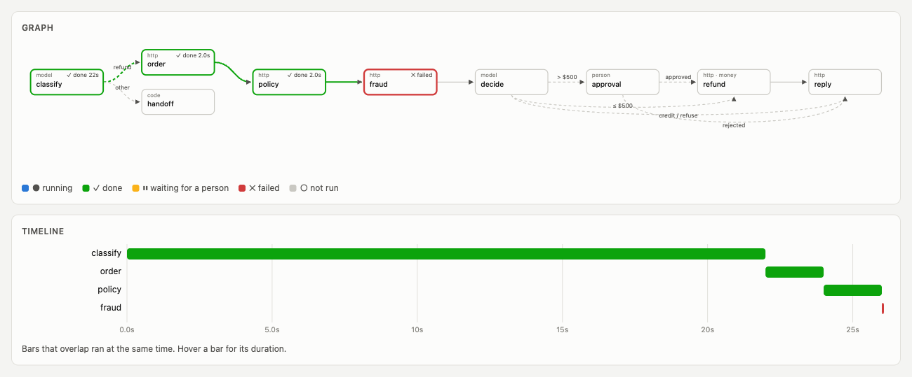
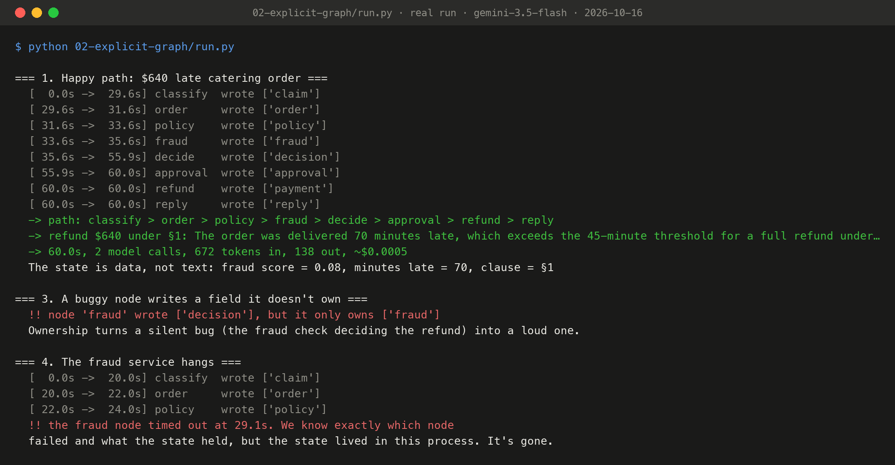

# Stage 2: write the structure down

Stop treating the agent as one long conversation and draw it as a graph: points with arrows between them. A graph has three parts.

| Part | What it is | In our refund |
|---|---|---|
| **State** | An object with named fields, designed *before* any prompt | `request, claim, order, policy, fraud, decision, approval, payment, reply` |
| **Nodes** | One job each: a function, one model call, a sub-agent or a person. A node reads the fields it needs and writes only the fields it owns | `classify` and `decide` (model), `order`, `policy`, `fraud` (HTTP), `approval` (a person), `refund`, `reply` |
| **Edges** | What may run after a node: **fixed**, or **conditional** (a router). Use plain code whenever code can decide | after `decide`: amount > $500 goes to `approval`. That rule is code, not a prompt |



- [`graph.py`](graph.py): the runner, about 40 lines. It walks the graph one node at a time and raises if a node writes a field it doesn't own.
- [`refund.py`](refund.py): state, then nodes, then edges, in that order on purpose.
- [`../agentkit/judgments.py`](../agentkit/judgments.py): the two model calls, each a narrow question with a typed (pydantic) answer through Gemini's structured output.

The loop hasn't disappeared. A node like `decide` could run its own small loop inside (stage 7 does). It has moved down a level: a loop handles one job inside one node, and the graph handles everything between nodes.

## Run it

```bash
.venv/bin/python 02-explicit-graph/run.py      # with `make platform` running
```

## What happened on a real run (gemini-3.5-flash, 2026-10-16)

| | Loop (stage 1) | Graph (stage 2) |
|---|---|---|
| Outcome | $640 refund under §1, approved | $640 refund under §1, approved |
| Model calls | 4: the model picks every step | 2 judgments: `classify`, `decide` |
| Tokens in | 4,809: the whole transcript, every call | 672: each node reads only its fields |
| "What was the fraud score?" | search the transcript | `state["fraud"]["score"]` → 0.08 |
| A node writes a field it doesn't own | silently corrupts the run | `PermissionError: node 'fraud' wrote ['decision'], but it only owns ['fraud']` |
| A complaint about a rider | depends on the prompt | `classify > handoff`, by an edge |

## Recorded run



*The live viewer replaying traced run `0080e4f9` at its last event: green nodes ran, green edges are the path the run took (worked out from the round numbers in its events). Screenshot by Playwright of `/ui?replay=0080e4f9`; the events are in [`viz/data/run-0080e4f9.json`](../viz/data/run-0080e4f9.json).*



*The live viewer replaying traced run `1272c3b0` at its last event: green nodes ran, green edges are the path the run took (worked out from the round numbers in its events). Screenshot by Playwright of `/ui?replay=1272c3b0`; the events are in [`viz/data/run-1272c3b0.json`](../viz/data/run-1272c3b0.json). The red node is the buggy `fraud` node stopped by field ownership.*



*Terminal output of `python 02-explicit-graph/run.py`, recorded on 2026-10-16 with gemini-3.5-flash (full text: [`output.txt`](output.txt)), rendered to PNG by [`viz/terminal.py`](../viz/terminal.py) from the file, not retyped.*

## Where it breaks

1. **Still serial.** The runner does one node at a time, so `order`, `policy` and `fraud` take 6 s even though the graph shows they're independent.
2. **A crash still loses the run.** We now know *which* node failed and what the state held, but that state only lived in memory.
3. **Still no pause.** The approval is a node now, but it still waits by blocking.

A diagram doesn't run anything by itself. The rules for *how* it executes are where most of the engineering is. **Next:** [stage 3](../03-supersteps/) runs it in supersteps.
