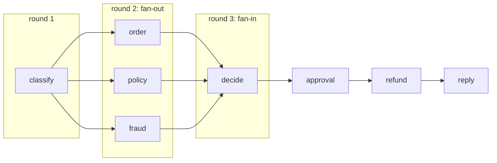

# Stage 3: supersteps

A diagram doesn't run itself. Most graph frameworks borrow their execution model from **Pregel**, the system Google described in 2010 for processing huge graphs like the web's link structure. The graph runs in rounds called **supersteps**:

1. Every node that is ready runs, **at the same time**.
2. Each reads a **snapshot** of the state as it stood at the start of the round.
3. When all have finished, their writes are applied **together**, combined by **reducers**.
4. The edges of the nodes that ran decide what's ready next.



- [`engine.py`](engine.py): about 100 lines. `add_edge(["order", "policy", "fraud"], "decide")` is a fan-in: `decide` waits for all three.
- [`refund.py`](refund.py): the same nodes as stage 2. The state now gives every field a reducer, or `None` for one writer per round.

## Run it

```bash
.venv/bin/python 03-supersteps/run.py          # with `make platform` running
```

## What happened on a real run (gemini-3.5-flash, 2026-10-16)

```
round 1 [ 0.0s ->  9.3s] classify                 wrote ['claim', 'spent']
round 2 [ 9.3s -> 11.3s] order + policy + fraud   wrote ['evidence', 'fraud', 'order', 'policy']
round 3 [11.3s -> 28.1s] decide                   wrote ['decision', 'spent']
round 4 [28.1s -> 32.2s] approval                 wrote ['approval']
```

- **Fan-out:** round 2 took 2 s, as long as its slowest lookup, instead of 6 s. (Free-tier model latency swings from 3 to 17 s per call, so compare the lookup rounds, not the totals.)
- **Reducers:** the three lookups each appended to `evidence` in the same round: `['order A-7731: $640, 70 min late', 'policy v3: 6 clauses', 'fraud score 0.08']`. `spent` adds up what each model call cost.
- **No reducer, no guessing:** take the reducer off `evidence` and the run stops with `InvalidUpdateError: 'evidence' got 3 writes in one round (from ['order', 'policy', 'fraud']) and has no reducer`. LangGraph behaves the same way.
- **Snapshots:** nodes in one round never see each other's half-finished work, so the result can't depend on which thread finished first (`tests/test_03_supersteps.py` proves it).

A loop never has to answer "which write wins?" because only one thing happens at a time. A graph makes you answer it up front, and in exchange it runs things in parallel safely.

## Where it breaks

1. **One failed node still loses the run.** When the fraud call hung in round 2, the order and policy results from the same round were thrown away with everything else.
2. **Still no pause.** The approval node still blocks.

The end of a round is a natural place to save: every node has finished and the state is consistent. **Next:** [stage 4](../04-checkpoints/) saves a checkpoint there.
