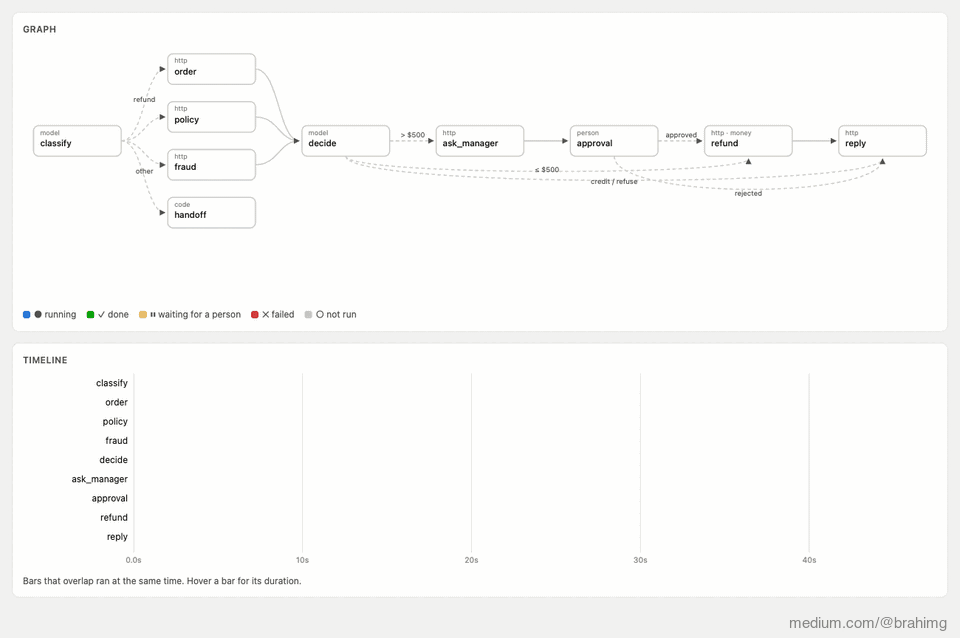
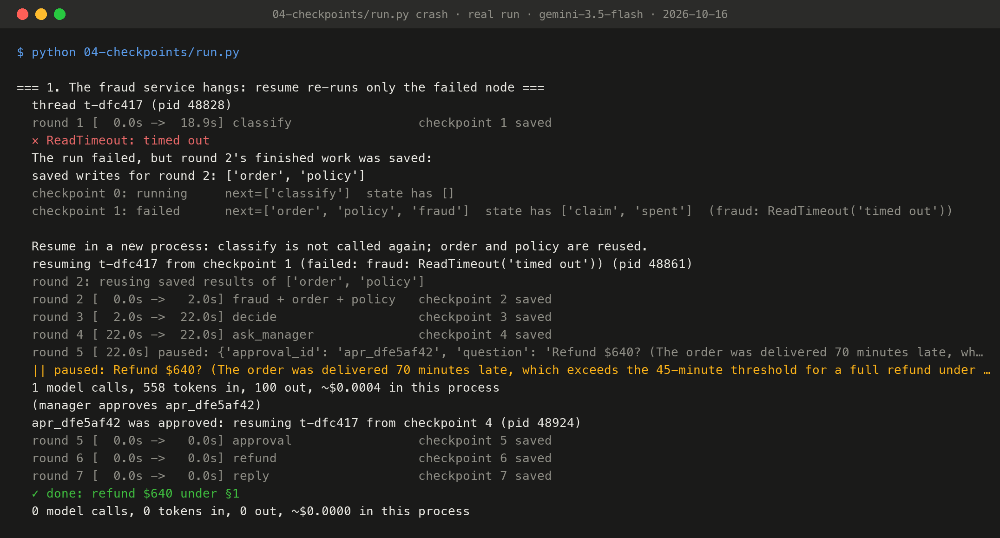
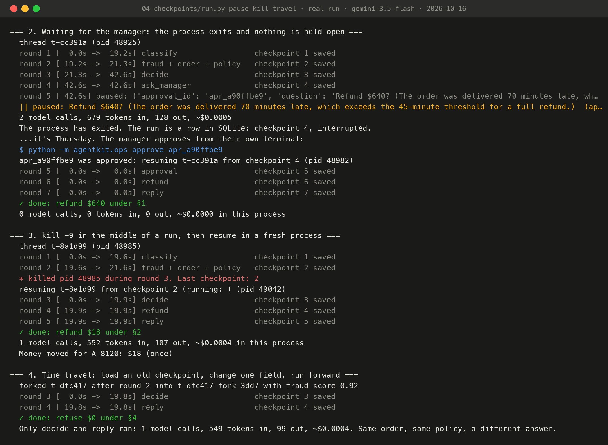
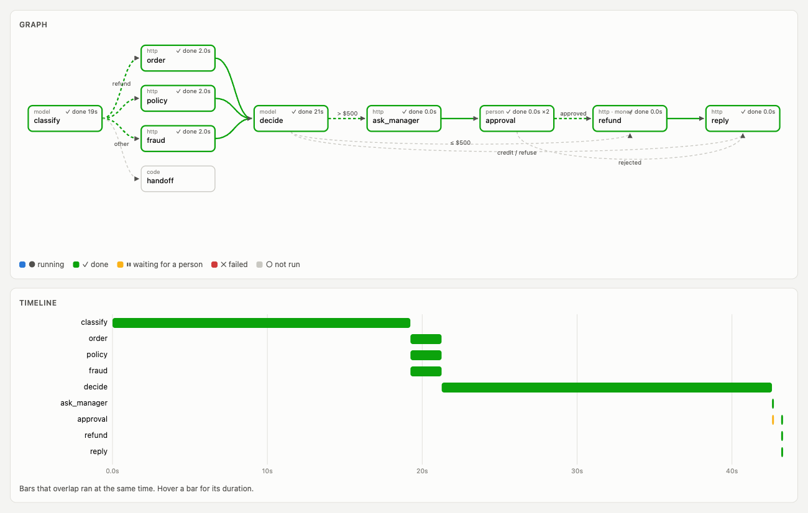

# Stage 4: checkpoints

The end of a superstep is a natural place to save: every node in the round has finished and the state is consistent. So after each round the engine writes the whole state to SQLite, with a note of which nodes are due next. That record is a **checkpoint**, and a run becomes a chain of them, one per round.

The same mechanism gives four things a loop can't do:

| | How |
|---|---|
| **Retry one node, not the run** | If a node fails, its siblings' finished results are saved (`writes` table). `resume()` re-runs only the failure |
| **A person is a node** | `interrupt()` stops the run cleanly. The process can exit. `resume(thread, answer)` continues days later, in any process |
| **Survive a crash** | Even `kill -9` loses at most the round in flight |
| **Audit trail and time travel** | Every checkpoint is a record of what the system knew. `fork()` copies one, changes a field, and runs forward |

Read [`engine.py`](engine.py) next to [`../03-supersteps/engine.py`](../03-supersteps/engine.py): the diff is the lesson. [`checkpoint.py`](checkpoint.py) is the store (about 100 lines, SQLite, typed state survives the round trip). In [`refund.py`](refund.py) the approval becomes two nodes: `ask_manager` sends the request once, and `approval` pauses:

```python
def approval(s):
    decision = interrupt({"approval_id": s["approval_request"]["id"], "question": "Refund $640?"})
    return {"approval": decision}      # on resume, interrupt() returns the manager's answer
```

## Run it

```bash
.venv/bin/python 04-checkpoints/run.py               # all scenes, with `make platform` running
.venv/bin/python 04-checkpoints/run.py start         # start a run yourself: it pauses and exits
.venv/bin/python -m agentkit.ops list                # you are the operations manager
.venv/bin/python -m agentkit.ops approve apr_...
.venv/bin/python 04-checkpoints/run.py resume t-...  # finish it, in a new process
.venv/bin/python 04-checkpoints/run.py history t-... # every checkpoint
```

Watch at http://127.0.0.1:8700/ui: a paused run turns amber and its process is gone. When it resumes, it carries on in the same timeline.

## What happened on a real run (gemini-3.5-flash, 2026-10-16)

**1. The fraud service hangs in round 2.** The run fails, but round 2's finished work is saved:

```
saved writes for round 2: ['order', 'policy']
checkpoint 1: failed   next=['order', 'policy', 'fraud']   (fraud: ReadTimeout('timed out'))
resuming t-fd963e from checkpoint 1 (pid 36479)
round 2: reusing saved results of ['order', 'policy']
```

The new process ran **only `fraud`** (2 s) and never called `classify` again. In the loop, the same failure cost a full restart (46.8 s and 6 model calls).

**2. The manager is out until Thursday.** The run paused at round 5 and **its process exited**. The run is a row in SQLite. The manager ran `python -m agentkit.ops approve apr_58bc3d59`, and a new process (pid 36353) resumed from checkpoint 4 and finished with no model calls: approval, refund, reply.

**3. `kill -9` during the model call in round 3.** The last checkpoint was 2. A fresh process resumed from there, ran `decide`, paid **$18 once** under §2, and replied.

**4. Time travel.** We forked a finished run after round 2 with the fraud score changed to 0.92. Only `decide` and `reply` ran (1 model call), and the answer became **refuse under §4**: same order, same policy, different facts. That's how you test a fix against a real past case.

## Recorded run



*Replay of real run `t-dfc417`: 71 frames sampled evenly over its 47 s (about 5× speed), captured by Playwright from `/ui?replay=t-dfc417` and assembled with ffmpeg by [`viz/make_gif.sh`](../viz/make_gif.sh). An MP4 of the same frames sits next to it. The red bar is the fraud call that hung; the next green bar is the only node the new process re-ran. Amber is the pause for the manager.*



*Terminal output of `python 04-checkpoints/run.py`, recorded on 2026-10-16 with gemini-3.5-flash (full text: [`output.txt`](output.txt)), rendered to PNG by [`viz/terminal.py`](../viz/terminal.py) from the file, not retyped.*



*Terminal output of `python 04-checkpoints/run.py`, recorded on 2026-10-16 with gemini-3.5-flash (full text: [`output.txt`](output.txt)), rendered to PNG by [`viz/terminal.py`](../viz/terminal.py) from the file, not retyped. Each `pid` is a separate process.*



*The live viewer replaying traced run `t-cc391a` at its last event: green nodes ran, green edges are the path the run took (worked out from the round numbers in its events). Screenshot by Playwright of `/ui?replay=t-cc391a`; the events are in [`viz/data/run-t-cc391a.json`](../viz/data/run-t-cc391a.json). `approval` ran twice: once to pause (the process then exited), once in a new process to resume.*

## Where it breaks

1. **Replays repeat side effects.** If the process dies *inside* the `refund` node, after the payment provider moved the money but before the checkpoint, the resume runs `refund` again from the top. The customer is paid twice.
2. **Nothing caps spend.** A run that loops through retries can keep calling the model.

**Next:** [stage 5](../05-side-effects/) adds idempotency keys and a budget in the state.
