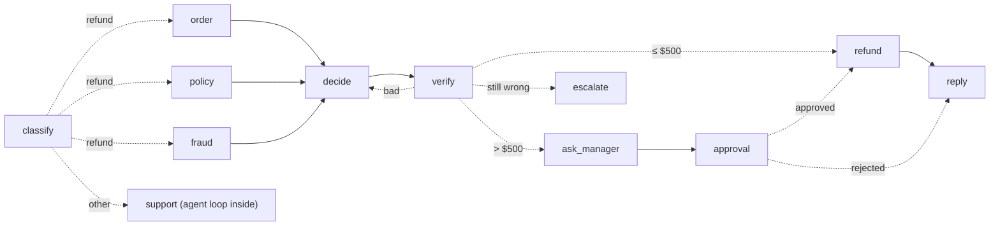
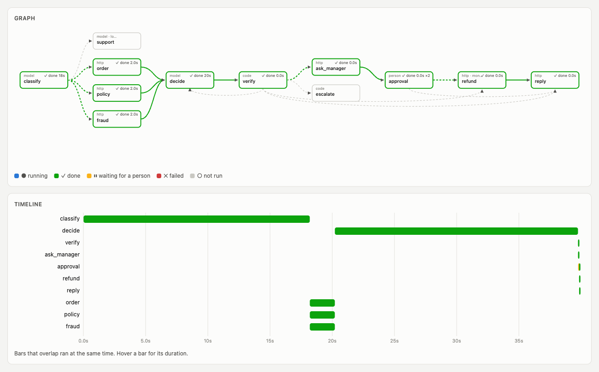
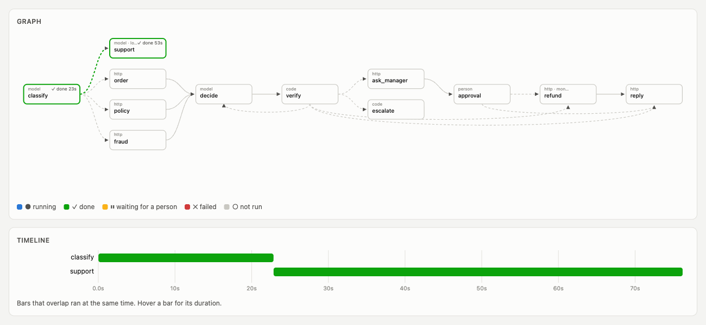
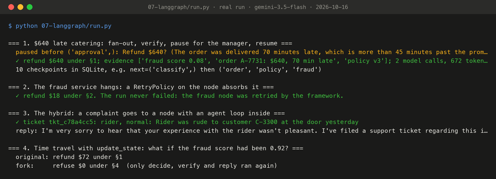

# Stage 7: the same graph on LangGraph

Everything we built by hand in stages 2 to 6 exists in LangGraph, the most widely used graph framework for agents, under nearly the same names:

| We built | LangGraph |
|---|---|
| Typed state with a reducer per field (stage 3) | `TypedDict` with `Annotated[list, operator.add]` |
| Fan-out and fan-in (stage 3) | `add_conditional_edges("classify", ..., ["order", "policy", "fraud"])`, `add_edge(["order", "policy", "fraud"], "decide")` |
| `InvalidUpdateError` when parallel writes have no reducer | The same error, the same name |
| Supersteps (stage 3) | LangGraph runs in Pregel supersteps too |
| SQLite checkpoints, `resume()`, `history()` (stage 4) | `SqliteSaver`, `invoke(None, config)`, `get_state_history(config)` |
| `interrupt()` for a person (stage 4) | `langgraph.types.interrupt`, resumed with `Command(resume="approved")` |
| `fork()` (stage 4) | `update_state(old_config, values)`, then `invoke(None, fork_config)` |
| Retry only the failed node (stage 4) | `RetryPolicy` on the node: the run doesn't even fail |
| Idempotency key = run + node (stage 5) | `config["configurable"]["thread_id"] + ":refund"` |

[`graph.py`](graph.py) is the whole refund graph in about 150 lines, including the verifier loop (stage 6) and the budget. The live viewer draws it from LangGraph's own `get_graph()`.

## The hybrid: a loop inside a node

A graph has to be drawn before the run, and some work can't be planned that far ahead. A complaint about a rider is open-ended: what to look up and what to file depends on what the customer wrote. So the `support` node runs a small agent loop *inside* it ([`support.py`](support.py)), the same design as stage 1, bounded by a step limit and two harmless tools (`get_order`, `create_ticket`).

This is the shape most real systems end up with: **a fixed graph outside for control, and a free-running loop inside the nodes that need room.**



## Run it

```bash
.venv/bin/python 07-langgraph/run.py              # with `make platform` running
.venv/bin/python 07-langgraph/run.py mermaid      # LangGraph draws its own diagram
```

## What happened on a real run (gemini-3.5-flash, 2026-10-16)

| Scene | Result |
|---|---|
| $640 late catering | Paused before `approval`; after `Command(resume="approved")`, refunded $640 under §1. Evidence merged by the reducer from three parallel nodes. 2 model calls, 672 tokens in. 10 checkpoints in SQLite |
| Fraud service hangs | `RetryPolicy` retried the node and **the run never failed**: $18 refunded under §2 |
| Complaint about a rider | `classify → support`. The loop inside filed `ticket rider, normal: "Rider was rude to customer C-3300 at the door yesterday"` and wrote the customer a reply |
| Time travel | `update_state` on the checkpoint before `decide` with fraud 0.92: the original refund of $72 under §1 became **refuse under §4**. Only `decide`, `verify` and `reply` ran again |

## Recorded run



*The live viewer replaying traced run `lg-22f714` at its last event: green nodes ran, green edges are the path the run took (worked out from the round numbers in its events). Screenshot by Playwright of `/ui?replay=lg-22f714`; the events are in [`viz/data/run-lg-22f714.json`](../viz/data/run-lg-22f714.json). The graph is LangGraph's own `get_graph()`; rounds are LangGraph's `langgraph_step`.*



*The live viewer replaying traced run `lg-b1f181` at its last event: green nodes ran, green edges are the path the run took (worked out from the round numbers in its events). Screenshot by Playwright of `/ui?replay=lg-b1f181`; the events are in [`viz/data/run-lg-b1f181.json`](../viz/data/run-lg-b1f181.json). One graph node, `support`, ran its own tool loop for 53 s and filed a ticket.*



*Terminal output of `python 07-langgraph/run.py`, recorded on 2026-10-16 with gemini-3.5-flash (full text: [`output.txt`](output.txt)), rendered to PNG by [`viz/terminal.py`](../viz/terminal.py) from the file, not retyped.*

## When *not* to use a graph

The structure has real costs. Parallel branches multiply spend. A graph splits work into nodes with partial views, which breaks down when every part depends on every other (like the middle of writing one piece of code). It has to be drawn before the run, which is wrong for open-ended debugging. And most real workflows are a straight line with one branch, where a framework adds moving parts and nothing else.

A fair test. Do you need any of these?

1. **Parallel work:** independent steps that could overlap?
2. **A pause for a person:** an approval that may take hours or days?
3. **Recovery mid-run:** steps slow or flaky enough that restarting from zero hurts?
4. **A record of every step:** an audit trail, or replaying a past case?

If the answer to all four is no, **a loop is fine.**

## The habit to keep

Write down the state before you write a single prompt. List the fields the system needs at each point of the run, and most of the architecture is already designed: the nodes are the things that fill those fields, and the edges are the rules for what's needed next. Then keep each node to one job, make an edge plain code whenever code can decide, save a checkpoint every round, give anything that touches money an idempotency key, put people in the graph as nodes and the budget in the state. And when you evaluate, look at the path and what it cost, not only the final answer.
