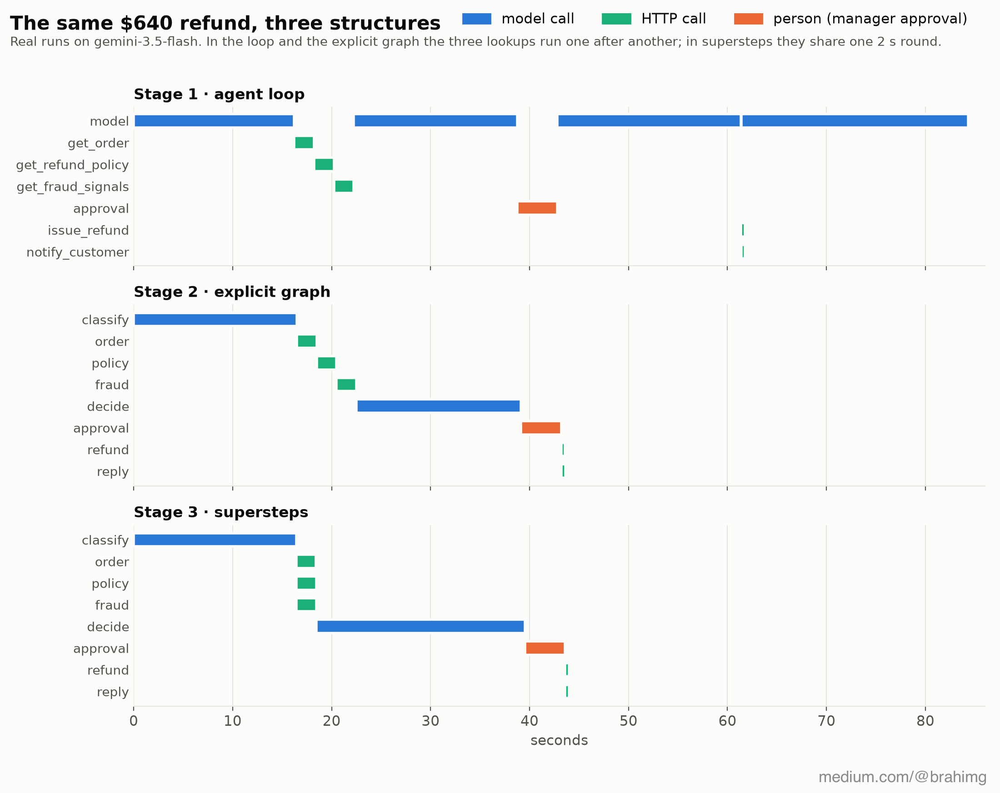
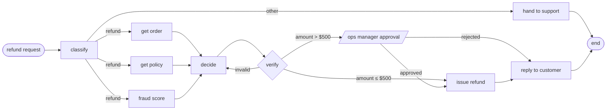
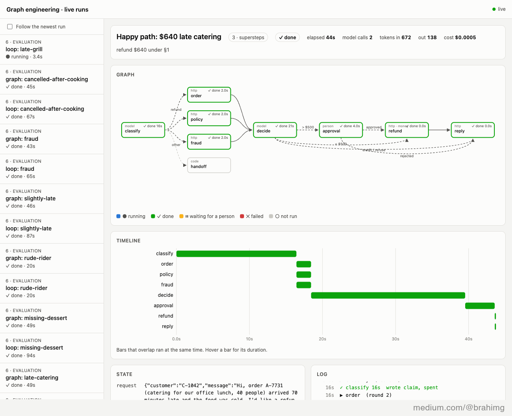
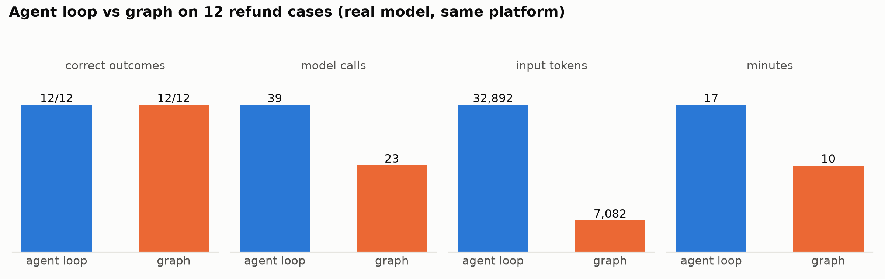

# Graph engineering from first principles

A course in runnable code. We take one real agent job from a food-delivery app and build it seven times, from the naive agent loop most people write first to a graph-engineered system. The job: a customer asks for a **$640 refund** on a catering order that arrived 70 minutes late and cold.

The final version runs independent steps in parallel, survives crashes, waits days for an operations manager, never pays twice, and checks the model's judgments before acting on them.

📝 The write-up: [I rebuilt one AI agent seven times to understand graph engineering](https://medium.com/@brahimg/i-rebuilt-one-ai-agent-seven-times-to-understand-graph-engineering-80b9983cd921) (Medium).

Everything is real: a real model (Gemini, free tier) with real tool calls and structured output, a real HTTP platform (orders, refund policy, fraud scoring, payments with idempotency keys, approvals), real crashes, SQLite checkpoints and a test suite. Each stage ends with **where it breaks**, which is the reason for the next one. Read the commits in order and the history reads like the course.



## The idea in one paragraph

An agent loop is a scheduler whose ready list always holds exactly one item, picked by a model call you can't inspect. A graph makes that structure explicit. **Nodes** do one job each (a function, one model call, a sub-agent or a person). **Edges** say what may run next (fixed, or conditional, and plain code whenever code can decide). **State** is a typed object, not a transcript. Run the graph in **supersteps** (Pregel, 2010) and you get safe parallelism. Save a **checkpoint** after every superstep and you get resume, human-in-the-loop pauses, time travel and an audit trail. Add **idempotency keys** to anything that touches money. The model is left with a handful of judgments, each small enough to verify.

## The target



## The stages

| # | Folder | What it adds | Where it breaks |
|---|---|---|---|
| 0 | [`services/`](services/), [`agentkit/`](agentkit/) | The food-delivery platform API (FastAPI) and the Gemini client every stage shares | — |
| 1 | [`01-agent-loop/`](01-agent-loop/) | The naive loop: Gemini picks the next tool call, the transcript is the memory | Serial calls, one timeout loses the run, it can't wait for a manager, and its state is a transcript |
| 2 | [`02-explicit-graph/`](02-explicit-graph/) | Typed state, nodes with one job each, fixed and conditional edges | Still one node at a time; a crash still loses everything |
| 3 | [`03-supersteps/`](03-supersteps/) | Pregel supersteps: fan-out, fan-in, snapshot reads, reducers | A crash still loses the run; still can't pause for days |
| 4 | [`04-checkpoints/`](04-checkpoints/) | A SQLite checkpoint per superstep: retry only the failed node, pause for a human across processes, time travel | Replaying the payment node can pay twice; nothing caps spend |
| 5 | [`05-side-effects/`](05-side-effects/) | Idempotency keys and a budget in the state | The model's judgments are still unchecked |
| 6 | [`06-reliability/`](06-reliability/) | A verifier and retries per node; an evaluation set comparing loop and graph on accuracy, path and cost | It's our own engine. How does a real framework do it? |
| 7 | [`07-langgraph/`](07-langgraph/) | The same graph in LangGraph, with a loop inside one node (the hybrid) | When *not* to use a graph |

## Run it

```bash
make setup                      # Python 3.11+, creates .venv
export GEMINI_API_KEY=...       # free: https://aistudio.google.com/apikey
make platform                   # terminal 1: the food-delivery API on :8700
.venv/bin/python 01-agent-loop/run.py   # terminal 2: any stage
make test                       # the tests need no key
```

## Watch it live

Open **http://127.0.0.1:8700/ui** while any stage runs. Every run streams its events to the platform, and the page shows them as they happen:

- **Graph:** the nodes light up as they run (blue), finish (green), fail (red) or wait for a person (amber).
- **Timeline:** one bar per node run. In stage 1 the lookups form a staircase; in stage 3 they're three bars side by side.
- **State:** the typed fields, flashing as nodes write them. The loop has only a transcript.
- **Log:** every node start, finish and failure, with times.



## Results

Real runs on gemini-3.5-flash, 2026-10-16:

| What we broke | Agent loop (stage 1) | Graph (stages 4 to 7) |
|---|---|---|
| The fraud service hangs once | Run lost; restart: 46.8 s, 6 model calls | Only the fraud node re-runs (LangGraph: `RetryPolicy`, the run never fails) |
| The manager is out until Thursday | Blocks, then gives up | Pauses, the process exits, resumes in a new process after `ops approve` |
| `kill -9` mid-run | Everything lost | Resumes from the last round |
| Crash right after paying | (no recovery at all) | Without a key: paid twice ($36). Key = run + node: paid once |
| A wrong decision (clause §7, double amount) | Paid as decided | Verifier rejects it; `decide` retries with feedback; $72 under §1 |

And on 12 cases (late, missing, spoiled, fraud, cancellation, complaint, Arabic, prompt injection), scored on the money that actually moved:

| Design | Correct | Model calls | Tokens in | Cost (list price) | Time |
|---|---|---|---|---|---|
| Agent loop | 12/12 | 39 | 32,892 | $0.0168 | 16.5 min |
| Graph | 12/12 | 23 | 7,082 | $0.0059 | 9.7 min |

Accuracy was a tie: a current model gets these steps right either way. The structure bought the rest: 78% fewer input tokens, a third of the cost, and a run that survives failures, people and replays.



Charts: [`viz/`](viz/), redrawn from real runs with `python viz/make_charts.py`.

## Where this comes from

None of this is new, which is the point: state machines, build tools (make, 1976), Pregel (Google, 2010), data-pipeline schedulers, durable workflow engines (Temporal) and payment-API idempotency keys. What's new is that some nodes are language models, which are slow, expensive and sometimes wrong, so the old discipline matters more.

## License

MIT
